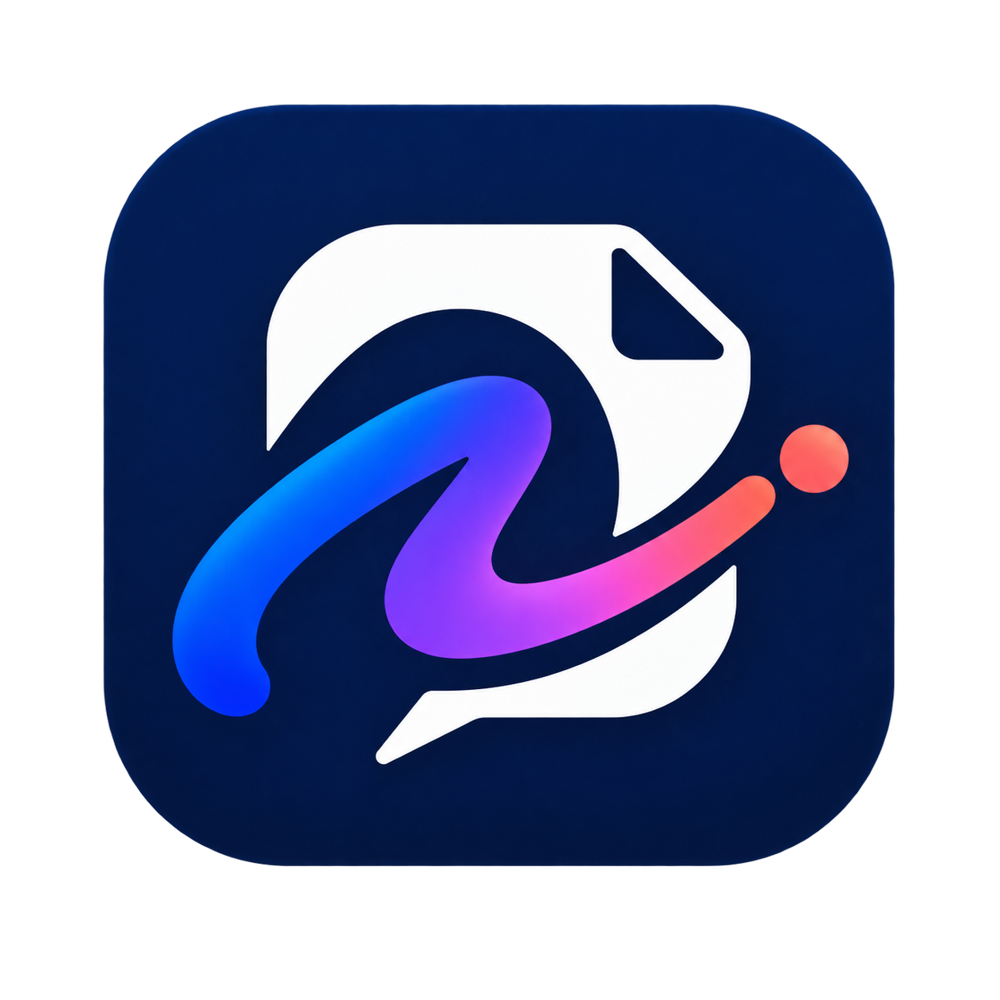

<p align="center">
  
</p>

# LinguaFlow

> **Mastery via Output** — 一套以「输出驱动」为核心的多语言沉浸式学习系统。

LinguaFlow 是一个**本地优先**的语言学习应用：学习数据默认存在你自己的设备上，由 AI 生成练习内容、陪你对话、纠正写作、把文字读给你听。它不追求「背多少单词」，而是逼你**真的去说、去写、去用**——因为语言只有在输出时才真正长在自己身上。

---

## 目录

- [这个项目能做什么](#这个项目能做什么)
- [支持的语言](#支持的语言)
- [核心功能（22 个模块）](./docs/features.md)
- [AI 与语音能力](./docs/ai-voice.md)
- [快速开始与配置](./docs/setup.md)
- [常见问题与限制](./docs/faq.md)
- [加入学习搭子社群（扫码进群）](./docs/contributing.md#想找一起学语言的搭子扫码进群)
- [许可、贡献与社区](./docs/contributing.md)
- [版本与更新日志](./CHANGELOG.md)

---

## 这个项目能做什么

围绕一个理念：**你学得最好的语言，是你用得最多的语言。** 应用把练习做成 **22 个「上手就能玩」的模块**（覆盖输入、输出、复习、社交、复盘完整闭环）：

| 你想练什么 | 用哪个模块 |
| --- | --- |
| 一站式入口、打卡与推荐 | 今日（Daily） |
| 沉浸式剧情对话、练口语思维 | 剧情对话（LinguaQuest） |
| 边读边听、练打字节奏 | 打字闯关（Typing Adventure） |
| 导入 EPUB/PDF、离线读书 | 书架（Books） |
| 长文写作、建自己的知识树 | 写作树（Writing Tree） |
| 系统化成文、从灵感到定稿 | 作文流水线（Composition Studio） |
| 自由写作、求批改 | 写作工坊（Writing Lab） |
| 攒例句、建个人语料 | 记忆库（Memory Bank） |
| 系统化背词 | 词汇（Vocabulary） |
| 沉淀错误、间隔复习 | 错题本（Error Book · SRS） |
| ……其余 12 个模块 | [核心功能详解 →](./docs/features.md) |

> 学习数据（进度、词汇、收藏）默认存在浏览器本地（localStorage / IndexedDB）；线上版可选开启云端同步，方便换设备取回。AI 使用**你自己填写的 API Key**，首次调用前会明确征得同意，可在「模型设置」随时关闭；关闭后相关功能自动走本地兜底。AI 对话内容按合规要求留痕 180 天。详见 [隐私说明](./docs/privacy.md) 与 [AI 与语音能力](./docs/ai-voice.md)。完整模块说明与考试评分体系见 [核心功能（22 个模块）](./docs/features.md)。

---

## 支持的语言

内置 **11 种**语言，可任意组合「母语 / 目标语言」：

🇬🇧 English · 🇯🇵 日本語 · 🇰🇷 한국어 · 🇪🇸 Español · 🇫🇷 Français · 🇩🇪 Deutsch · 🇨🇳 中文 · 🇮🇹 Italiano · 🇷🇺 Русский · 🇬🇷 Ελληνικά · 🇸🇦 العربية

> 中文 / 日文 / 韩文等含表意文字的语言，AI 会自动附带**罗马音 / 拼音 / 注音**等发音指引。

---

## 最近更新（v0.2.0）

| 新能力 | 说明 |
| --- | --- |
| **阅读工作台** | 书籍模式右栏：配套 B 站视频（可浮窗 / 拖拽 / 缩放）、AI 意群与难词（含 IPA）、划词进词库、划句进句子库；宽度可拖拽、可折叠。分页改为按句末边界切分，旧书自动迁移 |
| **左上角语言切换器** | 一键切换当前学习语言，只列已开启的语言（折叠态 / 移动端都有）；今日任务与今日产出线按「日期 × 语言」独立保存，切语言不再串台 |
| **AI 调用授权** | 首次 AI 调用弹窗说明 Key 归属、发送内容、服务器中转与 180 天留痕；「我的资料 → 模型设置」有常驻开关，可随时关闭走本地兜底 |
| **新人开箱内容** | 词库为空可一键导入 A1 起步词（日 / 韩来自内置词书）；日语五十音打字专项 8 组关卡，**免 AI、免 Key**；今日任务只推荐确实有内容的模块 |
| **TTS 缓存** | 内存 + IndexedDB 双层缓存（音频 Blob / URL + 过期时间），同一个词只合成一次，刷新页面后仍命中 |

线上正式版：<https://linguaflow.pathmora.cn/>（单域名同源，`/api/*` 反代到本地轻后端）。

---

## 快速开始

```bash
git clone https://github.com/Chmodpuppets/linguaflow.git
cd linguaflow
npm install
npm run dev               # 打开 http://127.0.0.1:3011

# 两个发行版（同一仓库、构建标志区分）
npm run build             # 开源版：无社区服务地址
npm run build:online      # 线上版：读 .env.online 注入 COMMUNITY_URL / APP_EDITION
```

> **生产构建不内置任何 API Key**。首次使用请到「我的资料 → 模型设置」填入自己的 Key —— 默认智谱 GLM · `glm-4-flash`，也支持 Qwen / OpenRouter / DeepSeek / 自定义 OpenAI 兼容端点；首次触发 AI 功能会先弹出授权说明。本地开发可把 Key 写进 `.env` 方便调试，但不会被打进 `dist`。
>
> TTS 朗读需另填 Qwen（DashScope）Key，未配时自动回落到浏览器语音；词库、五十音打字等内置内容**无需 Key 即可使用**。完整环境要求与配置项见 [快速开始与配置](./docs/setup.md)。

---

## 质量保证 / 截图回归

`qa/` 下有 **40+ 个 Playwright E2E 与 Node 单测脚本**，覆盖注册登录、AI 授权、语言切换、多语言任务 / 产出线隔离、新人内容、TTS 缓存等；`qa-playwright-capture.sh` 则对关键视图自动截图，便于版本间视觉回归。单测用 esbuild 现场打包真实 TS 源码，不依赖构建产物。

```bash
npm run dev                       # 终端 A：起 dev server（127.0.0.1:3011）
bash qa-playwright-capture.sh     # 终端 B：截图 7 个代表视图
node qa/e2e-ai-consent.mjs        # 单个 E2E（BASE_URL 可指向本地）
node qa/unit-tts-cache.mjs        # 单个单测，无需浏览器
```

- 截图输出到 `public/qa-screenshots/<view>.png`（今日 / 剧情对话 / 写作树 / 作文流水线 / 错误模式 / 词汇 / 歌曲跟打）。
- Vite 已配置 `host: '::'` 双栈，`localhost` / `127.0.0.1` 均可访问（早期的 IPv6-only 坑已修）。
- Playwright 脚本使用 `channel: 'chrome'` + `--no-proxy-server`；多数 E2E 用 `page.addInitScript` 注入本地会话，不依赖真实账号（服务端登录限流为 1 小时 10 次）。
- 首次运行会按需安装 Playwright + Chromium（需联网下载浏览器，失败时按提示手动 `npx playwright install chromium`）。

---

## 💬 加入学习搭子社群

> 一个人学语言，最大的敌人是 **孤独**。

我建了个**不卖课、不割韭菜**的外语学习群，就做三件事：**每日打卡 · 互相纠音纠错 · 素材共享**。不管你是日语 N5 还是法语 B2，只要认真在学一门语言，就欢迎你。

<p align="center">
  
</p>

扫码加我微信，备注「LinguaFlow」或你想学的语言，我拉你进群。进群后昵称改成「名字 + 在学的语言 + 水平」（如 `Mike · 日语 A1`）。

> 群规与更多说明见 [许可、贡献与社区 →](./docs/contributing.md#想找一起学语言的搭子扫码进群)。

---

## 许可与社区

本项目以 **CC BY-NC 4.0** 发布：**非商业免费 + 署名；商业使用须向作者购买授权**。完整条款、贡献约定与学习搭子社群见 [许可、贡献与社区](./docs/contributing.md)。

当前版本 **`v0.2.0`**，更新日志见 [CHANGELOG.md](./CHANGELOG.md)。

如果你觉得 LinguaFlow 有用，点个 Star ⭐ 就是最大的支持。

---

*LinguaFlow — Mastery via Output.*
